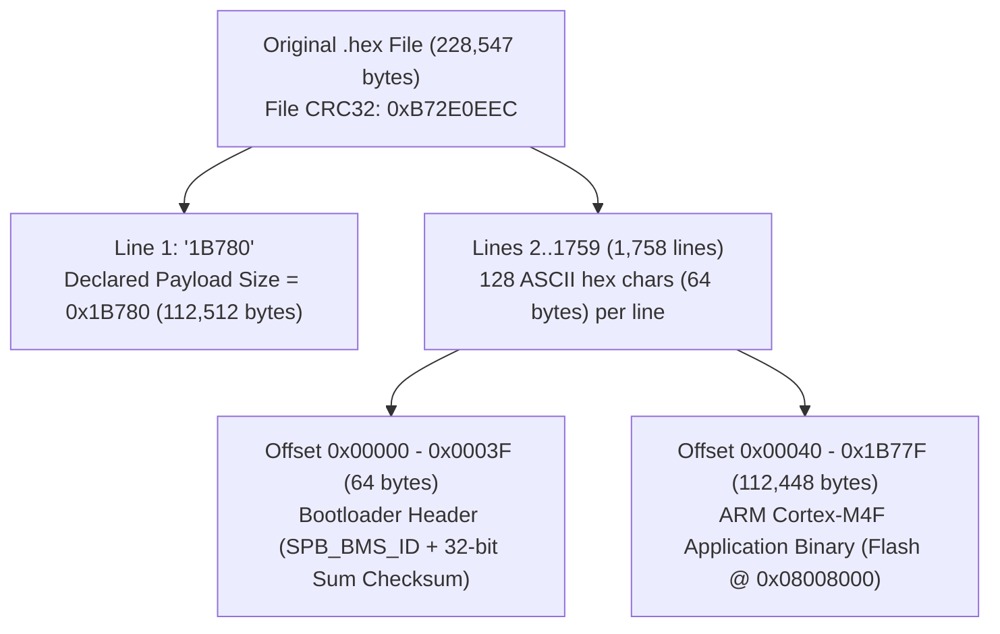

# BMS Firmware Reverse Engineering — Project Overview

## 1. Executive Summary

This project reverse-engineers a proprietary **Battery Management System (BMS)** firmware image (`V28`) designed for a **21S 70Ah NCM (Lithium Nickel Cobalt Manganese Oxide)** battery pack (tagged for the Nepal market: `尼泊尔21s70AhNCM`).

Through static analysis of the firmware container, vector table, and hardware initialization routines (`SystemInit`), we have identified the complete container format, checksum algorithms, memory map, communication interfaces, and exact target microcontroller (**Nations Technologies N32G45x** ARM Cortex-M4F).

---

## 2. Firmware Identification & Target Specifications

| Property | Value | Source / Notes |
| :--- | :--- | :--- |
| **Source File** | `6495.004615.SPB24-DVC24-006-1010-A30.尼泊尔21s70AhNCM.CAN(250k).UART.485(9600).V28.DL.260316.B72E0EEC.hex` | Original firmware container |
| **Project / Customer Code** | `6495.004615` | Also embedded in flash at `0x080151C3` (`6495.004615.A22.260316`) |
| **Hardware Board Model** | `SPB24-DVC24-006-1010-A30` | Bootloader header ID: `SPB_BMS_ID:6495-SPB24-DVC24-006-0606-A03` |
| **Battery Configuration** | **21S 70Ah NCM** (`尼泊尔21s70AhNCM`) | 21 series cells (~75.6 V nominal / 88.2 V max), 70 Ah capacity |
| **Communication Interfaces** | **CAN** (250 kbps), **UART**, **RS-485** (9600 baud) | Specified in filename & verified via peripheral IRQ handlers |
| **Firmware Version** | `V28` (`DL` build, `A22` internal tag) | Build date: **2026-03-16** (`260316`) |
| **Target MCU** | **Nations Tech N32G45x** (`N32G455` / `N32G457`) | ARM Cortex-M4F (Hardware FPU), up to 144 MHz, **144 KB SRAM** |
| **Toolchain / ABI** | ARM Compiler (Keil MDK / ARMCC) | Standard `__main` scatter-loading sequence at `0x08008198` |


the document folder contain the data sheet of the mcu used and and the schematic of the bms and other documents and the folder also consist the bms logic and can documentation file ---

## 3. Firmware Container & Memory Architecture

### 3.1 Custom `.hex` Container Layout

Despite the `.hex` file extension, the firmware file is **not** an Intel HEX (`:10...`) file. It uses a custom bootloader ASCII-hex format:



1. **File-Level Integrity (`0xB72E0EEC`)**:
   - The `.B72E0EEC.hex` suffix matches the standard IEEE 802.3 **CRC32** of the raw `.hex` file bytes.
2. **64-Byte Bootloader Header (`0x00000–0x0003F`)**:
   - `0x00..0x27` (40 B): ASCII string `SPB_BMS_ID:6495-SPB24-DVC24-006-0606-A03`
   - `0x28` (1 B): Null terminator (`0x00`)
   - `0x29..0x2C` (4 B): **Big-Endian 32-bit Byte-Sum Checksum (`0x00B2EF53`)** of the application binary (`sum(app_bytes) & 0xFFFFFFFF`).
   - `0x2D..0x3F` (19 B): `0xFF` flash padding.

### 3.2 MCU Memory Map (N32G45x)

| Region | Address Range | Size | Purpose |
| :--- | :--- | :--- | :--- |
| **Bootloader Flash** | `0x08000000 – 0x08007FFF` | 32 KB | On-chip bootloader (validates `SPB_BMS_ID` & checksum, handles IAP upgrades) |
| **Application Flash** | `0x08008000 – 0x0802373F` | ~109.8 KB (`112,448` B) | Main BMS application binary (`output/firmware_app_0x08008000.bin`) |
| **Option / Trim Info** | `0x1FFFF000 – 0x1FFFF7FF` | 2 KB | Factory trim & chip ID (`0x1FFFF298` checked against `"BKRI"` / `0x49524B42`) |
| **System SRAM** | `0x20000000 – 0x20023FFF` | 144 KB | Main RAM; Initial MSP (`SP`) set to `0x20023A60` (~142.6 KB) |
| **APB1 Peripherals** | `0x40000000 – 0x40007FFF` | 32 KB | TIM2/3, IWDG (`0x40003000`), USART2/3, UART4/5, CAN1 (`0x40006400`), PWR (`0x40007000`) |
| **APB2 Peripherals** | `0x40010000 – 0x400157FF` | 22 KB | AFIO (`0x40010000`), EXTI (`0x40010400`), GPIOA–G (`0x40010800–0x40012000`), USART1 (`0x40013800`) |
| **AHB Peripherals** | `0x40020000 – 0x40023FFF` | 16 KB | DMA1/2, RCC (`0x40021000`), FLASH Interface (`0x40022000`), ADC1/2/3/4 (`0x40020800+`) |
| **Cortex-M4 Private** | `0xE0000000 – 0xE00FFFFF` | 1 MB | NVIC, SysTick, SCB (`CPACR` @ `0xE000ED88` enables hardware FPU) |

---

## 4. Interrupt Vector Table & Key Entry Points

The vector table at `0x08008000` spans 102 entries (`0x198` bytes: 16 ARM core exceptions + 86 peripheral IRQs).

### 4.1 Core Startup & Exception Handlers

| Vector | Offset | Name | Target Address | Notes |
| :---: | :---: | :--- | :---: | :--- |
| 0 | `+0x000` | `Initial_MSP` | `0x20023A60` | Stack pointer near top of 144 KB SRAM |
| 1 | `+0x004` | `Reset_Handler` | `0x080081B0` | Calls `SystemInit` (`0x0801F4A8`), then branches to `__main` (`0x08008198`) |
| 2 | `+0x008` | `NMI_Handler` | `0x080173AC` | Non-maskable interrupt |
| 3 | `+0x00C` | `HardFault_Handler` | `0x08011470` | Custom fault handler |
| 4–6 | `+0x010..0x018` | `MemManage` / `Bus` / `UsageFault` | `0x08017220` / `0x0800A504` / `0x08020F18` | Dedicated fault handlers |
| 11 | `+0x02C` | `SVC_Handler` | `0x08019540` | Supervisor call |
| 14 | `+0x038` | `PendSV_Handler` | `0x080081C6` | Infinite loop stub (`B .`) |
| 15 | `+0x03C` | `SysTick_Handler` | `0x0801F468` | System tick timer ISR |

### 4.2 Active Peripheral Interrupts (N32G45x IRQ Map)

| IRQ # | Vector Offset | N32G45x Peripheral | Handler Address | Likely BMS Subsystem |
| :---: | :---: | :--- | :---: | :--- |
| **3** | `+0x04C` | `RTC_IRQHandler` | `0x0801821C` | Real-Time Clock / sleep wake-up |
| **6–10** | `+0x058..0x068` | `EXTI0` – `EXTI4` | `0x0800F35C`..`0x0800F3A4` | External interrupts (AFE alert, wake-up, short-circuit/current sense) |
| **20** | `+0x090` | `USB_LP_CAN1_RX0_IRQn` | `0x080207E0` | **CAN1 RX0** (250 kbps CAN bus receive ISR) |
| **23** | `+0x09C` | `EXTI9_5_IRQn` | `0x0800F3AA` | External pin group 5–9 ISR |
| **28** | `+0x0B0` | `TIM2_IRQn` | `0x0801F804` | Periodic timer 2 ISR |
| **29** | `+0x0B4` | `TIM3_IRQn` | `0x0801F81C` | Periodic timer 3 ISR |
| **37** | `+0x0D4` | `USART1_IRQn` | `0x0802057C` | **UART / RS-485** channel 1 ISR |
| **38** | `+0x0D8` | `USART2_IRQn` | `0x080205C4` | **UART / RS-485** channel 2 ISR |
| **39** | `+0x0DC` | `USART3_IRQn` | `0x0802060C` | **UART / RS-485** channel 3 ISR |
| **40** | `+0x0E0` | `EXTI15_10_IRQn` | `0x0800F362` | External pin group 10–15 ISR |
| **41** | `+0x0E4` | `RTCAlarm_IRQn` | `0x08017E7C` | RTC alarm wake-up ISR |
| **52** | `+0x110` | `UART4_IRQn` | `0x0801FE34` | **UART4** communication ISR |
| **64** | `+0x140` | `CAN2_RX0_IRQn` / `COMP` | `0x0800A6E0` | Secondary peripheral ISR |

---

## 5. Repository Structure & Tooling

```text
bms firmware reverse engineering/
├── 6495.004615.SPB24-DVC24-006-1010-A30...B72E0EEC.hex  # Original proprietary BMS firmware file
├── parse_hex.py                                         # Custom container parser, checksum verifier & exporter
├── requirements.txt                                     # Python dependencies (capstone, intelhex)
├── PROJECT_OVERVIEW.md                                  # This project overview document
├── .venv/                                               # Local Python virtual environment
└── output/
    ├── firmware_full.bin                                # Full 112,512-byte binary (64B header + app)
    ├── firmware_app_0x08008000.bin                      # Stripped 112,448-byte ARM binary (load @ 0x08008000)
    └── firmware_app_0x08008000.ihex                     # Standard Intel HEX pre-mapped to 0x08008000
```

### Quick Start Commands

```powershell
# Run the firmware parser and binary exporter
.\.venv\Scripts\python.exe parse_hex.py
```

### Disassembler Import Settings (Ghidra / IDA Pro / Binary Ninja)
- **File to Import**: `output/firmware_app_0x08008000.ihex` (auto-maps to `0x08008000`) or `output/firmware_app_0x08008000.bin`
- **Processor / Language**: `ARM Cortex-M4` / `ARMv7E-M`, **Little Endian**, **Thumb-2 + VFPv4-SP (FPU)**
- **Base / Load Address**: `0x08008000`
- **SRAM Region to Create**: `0x20000000` – `0x20023FFF` (`144 KB`, Read/Write)
- **Peripheral Region to Create**: `0x40000000` – `0x4002FFFF` (Read/Write, Volatile)

---

## 6. Reverse Engineering Roadmap & Status

1. **Phase 1 — Container & Architecture Identification (Completed)**
   - Decoded custom `.hex` format, verified file CRC32 (`0xB72E0EEC`) and header byte-sum checksum (`0x00B2EF53`).
   - Extracted raw `.bin` and standard `.ihex` images mapped at `0x08008000`.
   - Positively identified MCU as **Nations Technologies N32G452** (Cortex-M4F @ 144MHz, 144 KB SRAM).
2. **Phase 2 — Communication Protocol Reverse Engineering (Completed)**
   - Fully mapped **CAN 2.0B** @ 250 kbps: 29-bit extended frame format `(Priority:SID:DID:CMD:Index)`.
   - Documented Master (`0x14`) and Slave (`0x1D`) battery IDs, `"READ"` request structure, Modbus CRC16 (`0xA001`), and dual-pack battery switching commands.
   - Identified USART1/2/3 and UART5 for RS-485 / debug telemetry.
3. **Phase 3 — Analog Front-End (AFE) & Protection Logic (Completed)**
   - Identified AFE as **Nanjing Devechip DVC1124-1** (21S cell monitor, I2C slave `0x40`/`0x41`, CRC8 poly `0x07`).
   - Emulated Keil MDK `__scatterload` and decompressed packed data table (`0x08023184` -> Retention SRAM `0x20020000`).
   - Extracted factory calibrated limits: OVP = 4,185 mV, Balance = 4,120 mV, UV Warning = 2,831 mV, UV Cutoff = 2,621 mV, Nominal Capacity = 70 Ah.
4. **Phase 4 — Decompilation & Source Reconstruction (Completed)**
   - Performed headless Ghidra 12.2 auto-analysis and exported all 526 decompiled functions into [`decompiled/bms_firmware_decompiled.c`](file:///d:/kushal/projects/bms%20firmware%20reverse%20engineering/decompiled/bms_firmware_decompiled.c).
   - Reconstructed a clean, modular, and buildable embedded C project in [`firmware_source/`](file:///d:/kushal/projects/bms%20firmware%20reverse%20engineering/firmware_source/).
   - Verified algorithms and protection limits with native unit test suite ([`firmware_source/tests/test_bms_logic.c`](file:///d:/kushal/projects/bms%20firmware%20reverse%20engineering/firmware_source/tests/test_bms_logic.c)).

