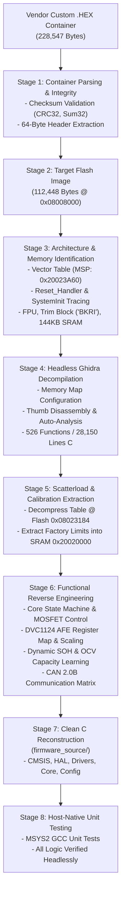

# BMS Firmware Reverse Engineering — Knowledge Base & Methodology

**Project:** 21S 70Ah NCM Battery Management System (Nepal EV Market)  
**Target Hardware:** Nations Technologies N32G45x (ARM Cortex-M4F) + Devechip DVC1124-1 AFE (24S)  
**Firmware Container:** `6495.004615.SPB24-DVC24-006-1010-A30.尼泊尔21s70AhNCM.CAN(250k).UART.485(9600).V28.DL.260316.B72E0EEC.hex`  
**Last Updated:** November 2026  

---

## 1. Executive Summary & Purpose

This Knowledge Base serves as the primary technical reference and engineering handbook for the reverse engineering of the 21S 70Ah NCM Battery Management System (BMS) firmware. It documents the end-to-end methodology, firmware container structures, cryptographic and checksum verifications, memory layouts, decompiled code analysis, and the clean C reconstruction pipeline.

---

## 2. End-to-End Reverse Engineering Workflow

The reverse engineering methodology follows a rigorous, multi-stage pipeline designed to transition from an opaque vendor delivery package to a verifiable, compilable C source repository.



### Stage 1: Container Parsing & Verification
1. **Container Structure:** Custom ASCII hexadecimal container (1,759 lines) with declared length `0x1B780` (112,512 bytes).
2. **Dual Integrity Verification:**
   - **Outer File CRC32 (`0xB72E0EEC`):** Standard IEEE 802.3 CRC32 calculated over the entire file matching the filename suffix.
   - **Inner 64-Byte Header Checksum (`0x00B2EF53`):** 32-bit big-endian arithmetic byte-sum calculated across the application payload:
     $$\sum_{i=64}^{112511} \text{Payload}[i] \equiv 0x00B2EF53 \pmod{2^{32}}$$
3. **Payload Separation:** Strip 64-byte bootloader header (`SPB_BMS_ID:6495-SPB24-DVC24-006-0606-A03`) to isolate the raw 112,448-byte application image.

### Stage 2: Architecture Identification & Memory Boundary Mapping
By analyzing the first 16 words of the binary:
- **Initial MSP (`0x20023A60`):** Points to the top of internal SRAM. The boundary `0x20024000` (144 KB) is the unique hardware signature of **Nations Technologies N32G45x series**.
- **Reset Vector (`0x080081B0`):** Branches directly to `SystemInit` (`0x0801F4A8`) and sets coprocessor access control `SCB->CPACR` (`0xE000ED88`) to `0x00F00000` to enable the ARM Cortex-M4 Single-Precision Hardware FPU (VFPv4-SP).
- **Factory Trim Signature (`0x1FFFF298`):** Compares against ASCII `"BKRI"` (`0x49524B42`), confirming the Nations Info Block layout.
- **VTOR Relocation:** Relocates vector table to base `0x08008000` (leaving `0x08000000–0x08007FFF` for factory IAP bootloader).

### Stage 3: Headless Decompilation & Static Analysis
- **Tooling:** Ghidra 12.2 running headless analysis via [`analyzeHeadless.bat`](file:///d:/kushal/projects/bms%20firmware%20reverse%20engineering/scripts/run_ghidra_headless.bat).
- **Target Language:** `ARM:LE:32:Cortex:default` (Thumb-2 mode).
- **Environment Setup:** Custom Java initialization script ([`scripts/GhidraSetupBms.java`](file:///d:/kushal/projects/bms%20firmware%20reverse%20engineering/scripts/GhidraSetupBms.java)) defining:
  - Flash: `0x08000000 - 0x0807FFFF`
  - SRAM: `0x20000000 - 0x2001FFFF` (Main SRAM 128KB)
  - Retention SRAM: `0x20020000 - 0x20023FFF` (Battery-backed SRAM 16KB)
  - Peripherals: `0x40000000 - 0x40023FFF`
  - System Control: `0xE000E000 - 0xE000EFFF`
- **Output:** 526 decompiled functions exported to [`decompiled/bms_firmware_decompiled.c`](file:///d:/kushal/projects/bms%20firmware%20reverse%20engineering/decompiled/bms_firmware_decompiled.c).

### Stage 4: Calibration Extraction via 3-Region Keil Scatterload Decompression
- The firmware uses Keil MDK scatter-loading (`__scatterload` at `0x080087FC`) with a 48-byte, 3-entry `RegionTable` at `0x08023154 – 0x08023184`:
  1. **Region 0 (`0x08023154`):** Decompresses `0x0802318C` into Retention SRAM `0x20020000` (`2,960 B` / `0x0B90` via `__decompress` @ `0x08008820`) — factory-calibrated protection thresholds, 2D OCV-SOC matrices, and NTC lookup tables.
  2. **Region 1 (`0x08023164`):** Decompresses `0x0802371C` into Main SRAM `0x20000000` (`6,040 B` / `0x1798` via `__decompress` @ `0x08008820`) — initialized `.data` state variables.
  3. **Region 2 (`0x08023174`):** Zero-initializes Retention SRAM `0x20020B90` (`11,984 B` / `0x2ED0` via `__scatterload_zeroinit` @ `0x08022F94`) — `.bss` runtime structures right up to `Initial_MSP` (`0x20023A60`).

---

## 3. Microcontroller & Board Architecture

### 3.1 Hardware Specifications
- **MCU:** Nations Technologies N32G452 / N32G457 (ARM Cortex-M4F @ 144 MHz)
- **Memory:** 512 KB Flash, 144 KB SRAM (128 KB standard + 16 KB retention SRAM)
- **Battery Configuration:** 21 Series, 1 Parallel (21S1P) NCM Chemistry
- **Pack Capacity:** 70 Ah nominal (51.8V nominal, 75.8V nominal stack)
- **Analog Front End:** Devechip DVC1124-1 (24-Channel Precision AFE)

### 3.2 Pinout Map (Board: SPB24-DVC24-006-0606-A03)

| Pin | MCU Function | Hardware Assignment | Description |
| :--- | :--- | :--- | :--- |
| **PA0** | GPIO Input | `ACC_WAKE` | Ignition switch input (Active HIGH) |
| **PB1** | GPIO Input | `CIN_DETECT` | Charger insertion detect (Active HIGH) |
| **PC2** | GPIO Input | `DIN_DETECT` | Discharge request detect (Active HIGH) |
| **PA8** | GPIO Output | `CHG_EN` | Main Charging MOSFET Gate Driver |
| **PC9** | GPIO Output | `DSG_EN` | Main Discharging MOSFET Gate Driver |
| **PC4** | GPIO Output | `PRECHARGE_EN` | Pre-charge current limiting path |
| **PB6 / PB10** | GPIO / I2C1 | `AFE_SCL` | DVC1124 I2C Clock line |
| **PB7 / PB11** | GPIO / I2C1 | `AFE_SDA` | DVC1124 I2C Data line |
| **PA11** | CAN1_RX | `CAN_RX` | Transceiver CAN RX (250 kbps) |
| **PA12** | CAN1_TX | `CAN_TX` | Transceiver CAN TX (250 kbps) |
| **PA9** | USART1_TX | `RS485_TX` | RS-485 / Modbus Diagnostic Port (9600 baud) |
| **PA10** | USART1_RX | `RS485_RX` | RS-485 / Modbus Diagnostic Port (9600 baud) |

---

## 4. Devechip DVC1124-1 AFE Deep Register Architecture

The DVC1124-1 is a 24-channel high-voltage battery monitor IC communicating with the MCU over a dedicated I2C interface.

### 4.1 Physical Protocol Layer
- **Interface:** Software bit-banged I2C on `GPIOB` (`0x40010C00`) with precise microsecond timing (`FUN_080121bc`).
- **7-Bit Slave Address:** `0x20`
  - I2C Write Byte: `0x40` (`0x20 << 1 | 0`)
  - I2C Read Byte: `0x41` (`0x20 << 1 | 1`)
- **Packet Error Checking (PEC / CRC8):**
  Every transaction uses an 8-bit CRC with polynomial $x^8 + x^2 + x + 1$ (`0x07`):
  ```c
  uint8_t dvc1124_calc_crc8(const uint8_t *data, uint16_t len);
  ```
- **Transaction Retries:** Firmware retries up to 5 times on NACK before declaring communication failure.

### 4.2 Recovered DVC1124 Register Map

The following registers were recovered directly from assembly transactions (`FUN_080122f0`, `FUN_08012760`, `FUN_08012720`):

| Address | Register Name | Access | Length | Description |
| :---: | :--- | :---: | :---: | :--- |
| **`0x00`** | `DVC_REG_SYS_CTRL` | R/W | 1 Byte | System Control (Reset, Sleep, Wakeup control) |
| **`0x01`** | `DVC_REG_CELL_MODE` | R/W | 1 Byte | Cell Count Mode (`0x0D` = 21S, `0x0E` = 22S, `0x0F` = 24S) |
| **`0x02`** | `DVC_REG_CURRENT` | Read | 2 Bytes | Signed 16-bit Pack Current ADC reading |
| **`0x06`** | `DVC_REG_ADC_CTRL` | R/W | 1 Byte | ADC Channel Sequencing & Clock Enable |
| **`0x07`** | `DVC_REG_ADC_CONFIG` | R/W | 2 Bytes | ADC Sample Rate and Averaging Filter |
| **`0x0B`** | `DVC_REG_CELL_STATUS` | Read | 2 Bytes | Hardware Alert Flags & Cell Measurement Status |
| **`0x0F`** | `DVC_REG_NTC_BASE` | Read | 14 Bytes | NTC Thermistor ADC Channels (up to 6 sensors) |
| **`0x1D`** | `DVC_REG_CELL_VOLTAGES` | Read | 42 Bytes | 21-Cell Voltage ADC readings ($21 \times 2$ bytes) |
| **`0x4F`** | `DVC_REG_PACK_VOLTAGE` | Read | 2 Bytes | Total High-Voltage Stack Voltage ADC reading |
| **`0x51`** | `DVC_REG_MEAS_CTRL` | R/W | 1 Byte | Measurement Trigger (Bit 7 = Trigger Scan, Bits [3:2] = Mode) |
| **`0x52`** | `DVC_REG_BURST_CELLS` | R/W | 40/3 B | Cell burst read (0x28 bytes) / Diagnostic burst write (3 bytes) |
| **`0x56`** | `DVC_REG_BALANCING_CTRL` | Write | 36 Bytes | Passive Balancing Control Matrix & Hardware Thresholds |
| **`0x5A`** | `DVC_REG_FAULT_STATUS` | R/W | 1 Byte | Fault Status Register (Cleared by writing `0xFE`) |
| **`0x5E`** | `DVC_REG_OVP_THRESH` | R/W | 1 Byte | Hardware Over-Voltage Cutoff Threshold |
| **`0x5F`** | `DVC_REG_OVP_DELAY` | R/W | 1 Byte | Hardware Over-Voltage Filter Delay |
| **`0x60`** | `DVC_REG_UVP_THRESH` | R/W | 1 Byte | Hardware Under-Voltage Cutoff Threshold |
| **`0x61`** | `DVC_REG_UVP_DELAY` | R/W | 1 Byte | Hardware Under-Voltage Filter Delay |
| **`0x62`** | `DVC_REG_TEMP_CONFIG` | R/W | 1 Byte | NTC Sensor Configuration & Channel Muxing |
| **`0x63`** | `DVC_REG_CHG_OCP` | R/W | 1 Byte | Hardware Charge Over-Current Protection Threshold |
| **`0x67`** | `DVC_REG_DSG_OCP1` | R/W | 1 Byte | Hardware Discharge Over-Current Level 1 Threshold |
| **`0x68`** | `DVC_REG_DSG_OCP2` | R/W | 1 Byte | Hardware Discharge Short-Circuit Level 2 Threshold |
| **`0x69`** | `DVC_REG_OCP_DELAY` | R/W | 1 Byte | Over-Current Protection Trip Delay |
| **`0x6E`** | `DVC_REG_AFE_CONFIG` | R/W | 1 Byte | AFE Hardware Core Configuration (`0xCD` normal / `0x8D`) |
| **`0x7E`** | `DVC_REG_CHIP_ID_VREF` | Read | 1 Byte | Chip Identification & Internal VREF Trim Calibration |
| **`0x8E`** | `DVC_REG_RESET_DIAG` | R/W | 1 Byte | AFE Soft Reset & Self-Diagnostic Control (`0x80`) |

### 4.3 Sensor Measurement & Conversion Formulas

Extracted directly from Flash literal pools and decompiled arithmetic routines:

#### 1. Cell Voltage Conversion (`FUN_0800d218` @ `0x0800D218`)
- **Gain (`DAT_0800d3bc`):** `0.0001f` ($0.1\text{ mV / count}$)
- **Offset (`DAT_0800d3c0`):** `0.0005f` ($0.5\text{ mV}$)
$$V_{\text{cell}} (\text{mV}) = (\text{Raw ADC Counts} \times 0.1) + 0.5$$

#### 2. Pack Current Conversion (`FUN_0800d48c` @ `0x0800D48C`)
- **Shunt Scaling Factor (`DAT_0800d52c`):** `0.005f` ($5\text{ mA / count}$ / $0.005\text{ A / count}$)
$$I_{\text{pack}} (\text{mA}) = -(\text{Raw ADC} - I_{\text{zero\_offset}}) \times 5.0$$
*(Negative sign indicates discharge current; positive sign indicates charge current).*

#### 3. NTC Temperature Conversion (`FUN_0800cfc0` @ `0x0800CFC0`)
- Reads NTC ADC ratio against VREF trim (`0x7E`), computes NTC resistance, looks up the 160-point calibration array, and converts to Celsius with a **$-40^\circ\text{C}$ offset**:
$$T (^\circ\text{C}) = \text{LookupIndex} - 40$$

#### 4. Per-Cell Voltage Gain Calibration (`FUN_08016000` @ `0x08016000`)
- Reads 21 individual 16-bit calibration words from EEPROM `0x0060`, divides each by the reference constant `DAT_08016140`, validates that the resulting multiplier is within safe bounds (defaulting to `1.0f` / `0x3F800000` if out of range), and multiplies each cell's raw millivolt reading individually.

### 4.4 Multi-AFE Chip Family Support (`DVC1124` / `DVC1117` / `DVC1114`) & 3-Phase Interleaved Balancing
- **Multi-AFE Dispatch (`FUN_08008af4` @ `0x08008AF4` & `FUN_08013a04` @ `0x08013A04`):** Dynamically branches on the configured AFE model ID (`*DAT_08009bd4`):
  - `0x0464` ($1124_{10}$) $\rightarrow$ **Devechip DVC1124** (up to 24S)
  - `0x045D` ($1117_{10}$) $\rightarrow$ **Devechip DVC1117** (up to 17S)
  - `0x045A` ($1114_{10}$) $\rightarrow$ **Devechip DVC1114** (up to 14S)
- **3-Phase Odd/Even Interleaved Cell Balancing (`FUN_08008af4`):** Masks the active balancing bitmask (`*DAT_08008c34`, `*DAT_08008c38`, `*DAT_08008c3c`) into **3 alternating phase groups** (cycling every 20 s / 50 s) and writes them to AFE registers **`0x67`, `0x68`, and `0x69`** so adjacent cells never balance simultaneously (preventing PCB overheating and sense-wire voltage distortion).

### 4.5 Hybrid Temperature Sensing: MCU Internal 12-Bit `ADC1`–`ADC4` (`0x40020800` / `0x40020C00`)
- **MCU Internal ADC Driver (`FUN_08008914` & `FUN_080089c0`):** Initializes, calibrates, and polls the N32G45x on-chip 12-bit ADCs (`ADC1 @ 0x40020800`, `ADC2 @ 0x40020C00`, `ADC3`, `ADC4`).
- **Sensor Fusion & Open-Wire Fault Masking (`FUN_0801f8ac` @ `0x0801F8AC`):** Merges DVC1124 NTC readings (`FUN_08009bd8`) with MCU internal ADC thermistor channels (`FUN_08016cfc`) to read **MOSFET temperature** (`iVar8 + 0x118`), **ambient/connector temperature** (`iVar6 + 0x40`), and upper cell NTCs. Includes open-sensor fault masking that substitutes MOSFET temperature if a cell NTC is disconnected (`< 25` raw counts and `> 10^\circ\text{C}$ delta).

---

## 5. Core BMS State Machine & Protection Engine

### 5.1 Calibrated Safety Thresholds (from Scatterload Table `0x08023184`)

| Protection Parameter | Threshold | Release | Trip Delay | Action |
| :--- | :--- | :--- | :--- | :--- |
| **Cell Over-Voltage (OVP)** | `4,185 mV` | `4,100 mV` | 100 ms | Open CHG MOSFET (PA8 = LOW) |
| **Cell Balancing Start** | `4,120 mV` | $\Delta V < 20\text{ mV}$ | Continuous | Engage passive bypass resistors via `0x56` |
| **Nominal Cell Voltage** | `3,608 mV` | — | — | Baseline 50% SOC voltage |
| **Under-Voltage Warning (UVW)** | `2,831 mV` | `3,000 mV` | 500 ms | Dashboard derate alert via CAN |
| **Under-Voltage Cutoff (UVC)** | `2,621 mV` | CIN active | 100 ms | Open DSG MOSFET (PC9 = LOW) |
| **Charge Over-Temperature** | `+55°C` | `+50°C` | 1000 ms | Discontinue charging |
| **Discharge Over-Temperature** | `+65°C` | `+60°C` | 1000 ms | Open DSG MOSFET |
| **MOSFET Over-Temperature** | `+85°C` | `+75°C` | 500 ms | Open both CHG & DSG MOSFETs |
| **Auxiliary Path Current Limit** | `2.0 A` | DIN active | 200 ms | Prevent battery drain through key ACC |

### 5.2 MOSFET Interlocking Logic
- **Discharge Permitted:** `(PA0 == HIGH) && (PC2 == HIGH) && (faults.all == 0)`
- **Charge Permitted:** `(PB1 == HIGH) && (!faults.bits.cell_ovp)`
- **Fault Safe State:** Pull both PA8 and PC9 LOW immediately within 10 ms.

### 5.3 Pre-Charge Contactor Sequencing (`FUN_0801647c`) & MOSFET Body-Diode Protection (`FUN_0801f580`)
- **Pre-Charge State Machine (`FUN_0801647c` @ `0x0801647C`):** Before closing the main discharge MOSFET (`PC9`), the firmware asserts `PC4` (`PRECHARGE_EN`, `state == 0x01`). If the capacitive load voltage fails to rise within 10 ticks, it transitions to pre-charge fault state `0x11`, opens all MOSFETs (`FUN_0800c8f4`), and logs black-box fault code **`0xBE`** (`FUN_08019844(0, 0xBE)`).
- **Body-Diode Conduction Promotion (`FUN_0801f580` @ `0x0801F580`):** If the Charge MOSFET is OFF (e.g., due to OVP) while discharge current (`local_18 > *DAT_08017164`) flows through its parasitic body diode (or if the Discharge MOSFET is OFF due to UVP while charging current flows), the firmware dynamically turns the inhibited MOSFET **ON** while current exceeds the threshold so its body diode does not overheat, turning it back **OFF** once current drops.

### 5.4 Deep-Sleep (`PWR STOP`) & `RTC` Alarm Wake-Up Subsystem (`0x08016148 – 0x08018330`)
- **RTC & BKP Configuration (`FUN_08016148` & `FUN_080161bc`):** Configures the N32G45x Real-Time Clock (`RTC @ 0x40002800`, unlock keys `0xCA` / `0x53`) and Backup Registers (`BKP @ 0x40006C00`, magic `0xA5A5`).
- **Sleep Entry & Wake-Up Recovery (`FUN_0801f7b8`, `FUN_08021748`, `FUN_08016360`):** When idle, disables peripheral clocks, arms wake-up interrupts (`EXTI0..4`, `EXTI9_5`, `EXTI15_10`, and `RTCAlarm_IRQn` on `EXTI17`), and enters `PWR` low-power mode (`0x40007000`). On wake-up, `FUN_08016360` restores the 144 MHz PLL, GPIOs, CAN1, and UARTs.

### 5.5 5-Stage LED SOC Bar-Graph Indicator (`FUN_0800fc48` @ `0x0800FC48`)
- Maps `SOC%` into 5 LED bar levels (`1..5`) with distinct hysteresis thresholds for charging (`<20%, <40%, <60%, <80%, >=80%`) versus discharging (`<10%` low-battery blink band, `<20%, <40%, <60%, <80%, >=80%`).

---

## 6. Dynamic State of Health (SOH) & Capacity Learning

The BMS employs a dual-mechanism model for State of Health:

### 6.1 Cycle Degradation Model (`FUN_080207fc` @ `0x080207FC`)
Executed in the periodic 1-second supervisor loop:
$$\text{SOH}_{\text{cycle}} = \max\left(0,\; 100.0 - (\text{cycle\_count} \times 0.02)\right)$$

- **Degradation Slope:** `0.02% / cycle` (`0x3CA3D70A`, initialized at Flash `0x08015310`).
- **Fresh Battery (0 cycles):** 100% SOH (70,000 mAh usable).
- **1,000 Cycles:** 80% SOH (56,000 mAh usable — EV retirement threshold).
- **SOH Output Register:** Retention SRAM `0x20020004`.
- **Cycle Count Register:** Retention SRAM `0x20022344`.

### 6.2 Dynamic OCV Capacity Learning (`FUN_0801b55c` & `FUN_08010654`)
- When battery rests in quiescent state ($|I| < 0.8\text{ A}$) for $>20$ samples, Open Circuit Voltage is compared to Coulomb integration.
- If divergence exceeds 3.0 Ah, dynamic recalibration updates learned Full Charge Capacity (FCC):
$$C_{\text{learned}} = \left(1.0 - \frac{2.0 \times (C_{\text{meas}} - C_{\text{est}})}{C_{\text{est}}}\right) \times C_{\text{est}}$$

### 6.3 2D Chemical OCV-SOC Lookup Table Engine

The battery chemical State of Charge is derived from cell open circuit voltage and pack temperature using dual 2D matrices extracted from the scatterload table (`0x08023184` decompressed into SRAM `0x20020572` and `0x20020720`):

#### 1. Chemical OCV Baseline at 25°C (21S 70Ah NCM)
The curve spans 21 SOC steps ($100\%$ down to $0\%$ in $5\%$ increments):
- **100%:** 4,185 mV (Calibrated Over-Voltage Cutoff)
- **95%:** 4,100 mV (OVP Release)
- **90%:** 4,040 mV | **85%:** 3,980 mV | **80%:** 3,920 mV
- **75%:** 3,870 mV | **70%:** 3,820 mV | **65%:** 3,770 mV
- **60%:** 3,720 mV | **55%:** 3,670 mV
- **50%:** 3,608 mV (Calibrated Nominal Cell Voltage)
- **45%:** 3,560 mV | **40%:** 3,510 mV | **35%:** 3,460 mV
- **30%:** 3,400 mV | **25%:** 3,340 mV | **20%:** 3,260 mV
- **15%:** 3,160 mV | **10%:** 3,020 mV
- **5%:** 2,831 mV (Calibrated Under-Voltage Warning)
- **0%:** 2,621 mV (Calibrated Under-Voltage Cutoff)

#### 2. Table 1: Chemical Capacity Availability Matrix ($21 \times 12$)
- **SRAM Address:** `0x20020572` (decompressed from Flash `0x08023184`, used in `FUN_08010654`).
- **Rows (21):** SOC $100\%$ to $0\%$ in $5\%$ intervals.
- **Columns (12):** Temperature bands ($< -20^\circ\text{C}$ up to $\ge 60^\circ\text{C}$).
- **Formula:** Capacity availability in Ah $= \text{Matrix}[row][col] \times 0.1$.
- Models chemical capacity loss under severe sub-zero cold ($<-20^\circ\text{C} \rightarrow 0\text{ Ah}$) versus optimal range ($25^\circ\text{C} \rightarrow 2.0\text{ Ah}$).

#### 3. Table 2: Thermal Voltage Relaxation Matrix ($21 \times 13$)
- **SRAM Address:** `0x20020720` (decompressed from Flash `0x08023184`, used in `FUN_080103c8`).
- **Rows (21):** SOC $100\%$ to $0\%$ in $5\%$ intervals.
- **Columns (13):** Temperature bands ($< 0^\circ\text{C}$ to $\ge 51^\circ\text{C}$).
- **Formula:** Thermal voltage shift $= \text{Matrix}[row][col] \times 0.01$.
- Compensates for NCM internal resistance impedance voltage sag across temperatures.

### 6.4 Parasitic Self-Discharge & BMS Quiescent Drain Compensation (`FUN_0801fc8c` @ `0x0801FC8C`)
- Every 75 rest intervals, the firmware calculates cumulative parasitic BMS board consumption plus temperature-dependent cell self-discharge (`(fVar10 + pfVar6[0x18] * *pfVar5) / 12.0`) and decrements remaining capacity (`pfVar5[2]`).

---

## 7. CAN 2.0B Communication Matrix (250 kbps)

### 7.1 29-Bit Extended Identifier Layout (Verified at `0x0801EF94` & `0x0800DAF4` and PDF Sec 2.2)
Disassembly of raw Thumb-2 instructions in `FUN_0801ef94` (`0x0801EF94`, ID packer) and `FUN_0800daf4` (`0x0800DAF4`, ID unpacker) confirmed the exact 29-bit extended identifier bit-field structure:
$$\text{CAN\_ID}_{29} = (\text{SID}_{4:0} \ll 24) \;\mid\; (\text{DID}_{4:0} \ll 16) \;\mid\; (\text{CMD}_{7:0} \ll 8) \;\mid\; \text{Index}_{7:0}$$

- **Bits `[28:24]` (`SID`):** Source ID — Master BMS = `0x14`, Slave BMS = `0x1D`, VCU = `0x01`
- **Bits `[23:21]`:** Reserved (`0b000`)
- **Bits `[20:16]` (`DID`):** Destination ID — Target Node ID, or Broadcast = `0x1F`
- **Bits `[15:8]` (`CMD`):** Primary Command Code
- **Bits `[7:0]` (`Index`):** Sub-Command / Parameter Index
- **Byte Order:** All multi-byte fields across the CAN protocol are **Little-Endian** (`LSB` first, `MSB` last).

### 7.2 Periodic Broadcast Schedule & Point-to-Point Command Matrix (PDF vs. Binary `0x08020F1C`)

| Function / Frame Description | PDF (`CAN documentation.pdf`) | Binary (`output/firmware_app_0x08008000.bin`) | DLC | Payload Layout (All Multi-Byte Fields Little-Endian) |
| :--- | :--- | :--- | :---: | :--- |
| **Broadcast: Fault Code & Bitmask** | `0x141F0E<ERR>` (`CMD=0x0E`, 1000 ms) | `CMD=0x0E, IDX=0x00/0x05` (1000 ms) | 8 | `Index=ERR`; `D0..D7`: 64-bit protection/fault bitmask |
| **Broadcast: Cap / SOC / SOH / MaxDsgI** | `0x141F1001` (`CMD=0x10, IDX=0x01`, 500 ms) | `CMD=0x40, IDX=0x01` (100 ms, `0x0801B55C`) | 7 | `D0-D1`: FCC ($10\text{mAh}$), `D2-D3`: Rem ($10\text{mAh}$), `D4`: SOC%, `D5`: SOH%, `D6`: Max DSG I ($1\text{A}$) |
| **Broadcast: State / I / V / Temps** | `0x141F1002` (`CMD=0x10, IDX=0x02`, 100 ms) | `CMD=0x40, IDX=0x02` (100 ms, `0x0801B764`) | 8 | `D0`: State (`0`=Idle,`1`=Chg,`2`=Dsg), `D1-D2`: I ($0.01\text{A}$), `D3-D5`: Pack V ($1\text{mV}$ 24b), `D6-D7`: Min/Max T ($+40^\circ\text{C}$) |
| **Broadcast: Switch / MOS / Key** | `0x141F1040` (`CMD=0x10, IDX=0x40`, 1000 ms) | `CMD=0x40, IDX=0x10` (1000 ms, `0x0801BA30`) | 7 | `D0`: DsgSwitch, `D1`: Addr, `D2`: Charger, `D3`: Load, `D4`: DSG MOS, `D5`: CHG MOS, `D6`: Key ACC |
| **Broadcast: Parallel Status** | `0x141F1101` (`CMD=0x11, IDX=0x01`, 100 ms) | `CMD=0x40, IDX=0x11` (1000 ms, `0x0801BADC`) | 5 | `D0`: ParallelFlag, `D1`: ActiveBat (`1`/`2`), `D2`: Charger, `D3`: SwitchState, `D4`: BatCount |
| **Broadcast: Pack Rating** | `0x141F1201` (`CMD=0x12, IDX=0x01`, 500 ms) | `CMD=0x40, IDX=0x12` (1000 ms, `0x0801BC04`) | 8 | `D0`: 21S, `D1`: 1P, `D2-D3`: 7000 ($10\text{mAh}$ LE), `D4`: MaxChgI ($0.4\text{A}$), `D5`: MaxDsgI ($1\text{A}$), `D6-D7`: 1000 Cycles (LE) |
| **P2P: Set Equipment ID** | `CMD=0x00, IDX=0x01` | — | 1 | Sets BMS node SID to `D0`, replies with General Ack `CMD=0x0A` |
| **P2P: Long Packet Multi-Frame** | `CMD=0x04, IDX=1..N` | `CMD=0x04, IDX=1..N` (`0x0801C154`) | 8 | `[OrigCMD, SubCMD, LenLo, LenHi, Data..., CRC16_Lo, CRC16_Hi]` |
| **P2P: General Ack Response** | `CMD=0x0A, IDX=AckCMD` | — | 3 | `D0`: AckCMD, `D1`: AckIDX, `D2`: Status (`0x00`=OK, `0x01`=Fail) |
| **P2P: HWVER / FWVER / SN** | `CMD=0x11, IDX=0x01..0x03` | `CMD=0x11, IDX=0x01..0x03` | 8 | Replies via `CMD=0x04` Long Packet: `"A10.0"`, `"V02.0"`, or 24B Serial Number |
| **P2P: Telemetry Read/Write** | `CMD=0x14, IDX=0x01..0x06, 0x10` | `CMD=0x40, IDX=0x01..0x05, 0x10` | 1–8 | `0x03`: NTC1..4+MOS+Conn, `0x04`: Accum Chg/Dsg mAh (32b LE), `0x05/0x06`: Door Lock |
| **P2P: OTA Upgrade Trigger** | `CMD=0x1A, IDX=0x00` (`"UPDATE"`) | — | 6 | Sets OTA flag, writes `0x28A` boot flag & replies with General Ack `CMD=0x0A` |
| **Broadcast: Bus Silence** | `CMD=0x1F, IDX=0x1F` (`"SILENCE"`) | — | 7 | Silences periodic CAN broadcasts (`DID=0x1F`) |
| **P2P: Pack Rating & Cycles** | `CMD=0x40, IDX=0x01, 0x02` | `CMD=0x41, IDX=0x01, 0x02` | 8 | `0x01`: Pack Rating; `0x02`: Cycles, Uncharged Hours, Est Chg Time ($0.1\text{min}$ LE) |
| **P2P: Cell Voltages 1–24** | `CMD=0x41, IDX=0x03..0x08` | `CMD=0x41, IDX=0x03..0x08` (`0x0801BE1A`) | 8 | 4 cells/frame, **16-bit Little-Endian** mV per cell |
| **P2P: Cell Balancing 1–24** | `CMD=0x42, IDX=0x10..0x12` | `CMD=0x41, IDX=0x10..0x12` (`0x0801BFDC`) | 8 | 8 cells/frame (`1` = balancing active, `0` = off) |
| **P2P: Control & System Info** | `CMD=0x43, IDX=0x01,0x03,0x04,0xF2` | `CMD=0x42, IDX=0x01, 0x03, 0x04` | 1–4 | `0x01`: Ver `00 00 01 03` (v1.3), `0x03`: Switch Pack, `0x04`: Idle Hours, `0xF2`: Reset/Sleep |
| **Binary-Only: Custom Calib** | *(Undocumented)* | `CMD=0x44, IDX=0x01..0x03, 0xF1..0xF3` | 8 | Reads/writes internal calibration & protection parameter blocks |
| **Internal Parallel Bus** | *(Undocumented)* | Std 11-bit `0x101..0x106`, `0x201..0x203`, Ext `0x141DF001` | 8 | Inter-pack dual-battery arbitration (`FUN_0801ca08`, `FUN_0801f044`) |

---

## 8. Clean C Reconstruction Guidelines & Verification

All recovered components are integrated into the modular C skeleton in [`firmware_source/`](file:///d:/kushal/projects/bms%20firmware%20reverse%20engineering/firmware_source/):

- `include/bms_config.h`: Central hardware constants, calibrated limits, and timings.
- `include/bms_types.h`: Structured telemetry, switch status, and bitfield fault flags.
- `include/dvc1124_afe.h`: Complete AFE register definitions, scaling factors, and prototypes.
- `src/dvc1124_afe.c`: AFE driver implementing register reads, ADC scaling, and CRC8.
- `src/bms_ocv.c`: 2D OCV-SOC lookup engine, chemical curves, and temperature derating.
- `src/bms_core.c`: Core state machine, safety supervisor, and SOH cycle degradation.
- `src/bms_can.c`: CAN 2.0B communication engine and frame pack/unpack routines.
- `src/bms_parallel.c`: Multi-pack master/slave parallel arbitration.
- `src/bms_modbus.c`: RS-485 / Modbus RTU and proprietary diagnostic protocol engine.
- `src/bms_storage.c`: 24Cxx non-volatile EEPROM storage and calibration manager.
- `src/bms_hal.c`: Hardware abstraction layer with host-simulation fallbacks.
- `tests/test_bms_logic.c`: Native host unit test runner (15 unit test suites).

---

## 9. RS-485 / Modbus RTU & PC Diagnostic Protocol Engine

The firmware provides external diagnostics, PC upper-computer telemetry, and battery calibration parameter read/write access over RS-485 / UART (`0x08014000 - 0x08019000`, 131 functions).

### 9.1 Hardware Serial Interface & Unified 7-Port UART Driver
- **Physical Pins:** PA9 (USART1_TX), PA10 (USART1_RX) / PB10, PB11 (USART3).
- **Unified 7-UART Architecture (`0x08015EA8 – 0x08015EF0` & `0x08020060 – 0x08020088`):** Supports all 7 N32G45x serial controllers — `USART1` (`0x40013800`), `USART2` (`0x40004400`), `USART3` (`0x40004800`), `UART4` (`0x40004C00`), `UART5` (`0x40005000`), `UART6` (`0x40015000`), and `UART7` (`0x40015400`) — with RS-485 DE/RE direction-pin control in `FUN_08016420` (`0x08016420`).
- **Default Baud Rate:** 9600 baud, 8 data bits, no parity, 1 stop bit (8N1). Configurable dynamically in `FUN_08015b28(port, 0x2580)`.
- **Modbus Slave ID:** Default `0x01` (stored at `EEPROM_ADDR_COMM_CONFIG` `0x0120`).

### 9.2 Modbus RTU Frame Specification & CRC16 Engine
- **CRC-16 Algorithm:** Reconstructed from `FUN_0800c754`. Standard Modbus polynomial `0xA001`, initial seed `0xFFFF`, low byte transmitted first.
- **Supported Function Codes:**
  - `0x03` (`MODBUS_FC_READ_HOLDING_REGS`): Read operational data & protection parameters.
  - `0x04` (`MODBUS_FC_READ_INPUT_REGS`): Read real-time telemetry.
  - `0x06` (`MODBUS_FC_WRITE_SINGLE_REG`): Write single parameter or trigger control.
  - `0x10` (`MODBUS_FC_WRITE_MULTIPLE_REGS`): Batch write calibration tables.

### 9.3 Modbus Register Map

| Register Address | Data Type | Units / Scale | Description |
| :---: | :---: | :---: | :--- |
| `0x0001` – `0x0015` | `uint16_t` | $1\text{ mV}$ | Individual Cell Voltages 1 through 21 |
| `0x0016` | `uint16_t` | $10\text{ mV}$ | Total Battery Pack Voltage (e.g. $7660 \rightarrow 76.6\text{ V}$) |
| `0x0017` | `int16_t` | $10\text{ mA}$ | Battery Pack Current (signed: $+$ charge, $-$ discharge) |
| `0x0018` | `uint16_t` | $0.1\%$ | State of Charge (SOC: $0 \rightarrow 1000 = 0.0\% \rightarrow 100.0\%$) |
| `0x0019` | `uint16_t` | $0.1\%$ | State of Health (SOH: $0 \rightarrow 1000 = 0.0\% \rightarrow 100.0\%$) |
| `0x001A` | `uint16_t` | $0.1\text{ Ah}$ | Remaining Pack Capacity ($350 = 35.0\text{ Ah}$) |
| `0x001B` | `uint16_t` | $0.1\text{ Ah}$ | Nominal Full Pack Capacity ($700 = 70.0\text{ Ah}$) |
| `0x001C` | `uint16_t` | Counts | Lifetime Full Discharge Cycle Count |
| `0x001D` | `uint16_t` | $1\text{ mV}$ | Highest Cell Voltage ($\max(V_{\text{cell}})$) |
| `0x001E` | `uint16_t` | $1\text{ mV}$ | Lowest Cell Voltage ($\min(V_{\text{cell}})$) |
| `0x001F` | `uint16_t` | $1\text{ mV}$ | Maximum Cell Voltage Imbalance ($\Delta V = \max - \min$) |
| `0x0020` – `0x0023` | `int16_t` | $0.1^\circ\text{C}$ | Cell Temperatures NTC 1 through 4 |
| `0x0024` | `int16_t` | $0.1^\circ\text{C}$ | Power MOSFET Stage Temperature |
| `0x0025` | `int16_t` | $0.1^\circ\text{C}$ | Ambient Temperature |
| `0x0030` | `uint16_t` | Enum | BMS State ($0$: INIT, $1$: STANDBY, $2$: CHG, $3$: DSG, $4$: FAULT) |
| `0x0031` | `uint16_t` | Bitfield | Active Protection / Fault Bitmask |
| `0x0032` | `uint16_t` | Bitfield | MOSFET Status (Bit 0: CHG MOS, Bit 1: DSG MOS) |
| `0x0040` | `uint16_t` | $1\text{ mV}$ | Cell Over-Voltage Protection Threshold (OVP: $4185\text{ mV}$) |
| `0x0041` | `uint16_t` | $1\text{ mV}$ | Cell Under-Voltage Protection Threshold (UVP: $2621\text{ mV}$) |
| `0x0042` | `uint16_t` | $10\text{ mA}$ | Charge Over-Current Limit (OCP Chg: $3500 \rightarrow 35.0\text{ A}$) |
| `0x0043` | `uint16_t` | $10\text{ mA}$ | Discharge Over-Current Limit (OCP Dsg: $7000 \rightarrow 70.0\text{ A}$) |
| `0x0044` | `int16_t` | $0.1^\circ\text{C}$ | Over-Temperature Cutoff ($650 \rightarrow 65.0^\circ\text{C}$) |
| `0x0045` | `int16_t` | $0.1^\circ\text{C}$ | Under-Temperature Cutoff ($-100 \rightarrow -10.0^\circ\text{C}$) |

### 9.4 Proprietary Upper-Computer Diagnostic Protocol (0xEA 0xD1)
For high-speed factory automated testing and host telemetry polling (`FUN_0801cd98`), the firmware uses tagged frames with XOR checksums (`FUN_0800c0d0`):
- **Header:** `0xEA 0xD1` (or `0xEB 0x01`)
- **Structure:** `[0xEA] [0xD1] [SlaveID] [Len 0x39] [0xFF] [Cmd 0x03] [Tagged Payload] [XOR Checksum]`
- **Payload Tags:** Tag 2: State, Tag 3: Current, Tag 5: Stack Voltage, Tag 7: SOC, Tag 8: SOH, Tag 9: Max Cell, Tag 10: Min Cell, Tag 11: Delta, Tag 12: NTC1..4/MOS/Amb ($+40^\circ\text{C}$ offset).
- **Bluetooth AT Command Framing:** Formats `"AT+NAME <PackName>\r\n"` on UART ports for auto-configuration of BLE dongles (`FUN_0800b454`).

---

## 10. 24Cxx Non-Volatile EEPROM Storage & Parameter Persistence

The BMS features an external I2C serial EEPROM (AT24C32 / AT24C64 / 24C128) for persistent parameter storage, factory calibration, and lifetime tracking (`0x08012000 - 0x08014000`, 36 functions).

### 10.1 Physical Bus & Watchdog Protection
- **Bus:** Software bit-banged I2C on `GPIOC` (`0x40011400`) pins with delay loops (`FUN_08012180`).
- **Independent Watchdog Keep-Alive:** The EEPROM delay loops reload `IWDG` (`0x40003000`) with key `0xAAAA` on every bit transmission to prevent watchdog resets during slow EEPROM multi-byte writes.
- **32-Byte Page Boundary Management:** Writes are partitioned into physical 32-byte pages:
  $$\text{Page Remaining} = \left(\left(\frac{\text{addr}}{32} + 1\right) \times 32\right) - \text{addr}$$
- **Read-Back Verification (`FUN_080127e0`):** Every written page is immediately read back and verified byte-by-byte. If verification fails, the operation retries up to 5 times (`EEPROM_MAX_RETRIES`).

### 10.2 EEPROM Memory Map Allocation

| Memory Address | Length | Checksum Addr | Description |
| :---: | :---: | :---: | :--- |
| `0x0020` | 27 Bytes | `0x015F` | **System Protection Configuration:** OVP, UVP, OCP, OTP, UTP thresholds |
| `0x0048` | 1 Byte | — | **Cell Configuration:** Number of series cells ($21$) |
| `0x004E` | 16 Bytes | `0x005E` | **Battery Specifications:** Nominal capacity ($70.0\text{ Ah}$), voltage ($76.6\text{ V}$) |
| `0x0060` | 32 Bytes | — | **Cell Voltage Calibration Gain Multipliers:** Cells 1 through 16 |
| `0x0080` | 10 Bytes | — | **Cell Voltage Calibration Gain Multipliers:** Cells 17 through 21 |
| `0x00A0` | 20 Bytes | — | **Current Sensor Shunt Calibration:** Zero-point offset and gain factor |
| `0x00B4` | 11 Bytes | `0x015C` | **NTC Temperature Calibration Offsets:** Sensors 1 through 4, MOS temp |
| `0x00C0` | 32 Bytes | `0x015B` | **Pack Serial Number / Barcode:** ASCII `"SPB24-DVC24-006-1010-A30"` |
| `0x00E0` | 32 Bytes | `0x0162` | **Bluetooth Device Name:** ASCII name for BLE module pairing |
| `0x0120` | 30 Bytes | `0x015E` | **Communication Config:** CAN baud ($250\text{k}$), Modbus baud ($9600$), Slave ID |
| `0x0140` | 24 Bytes | `0x015D` | **Hardware Metadata:** PCB revision, manufacturer code, production date |
| `0x0180` | 4 Bytes (u32) | — | **Cumulative Discharge Capacity:** Total Ah discharged over lifetime |
| `0x0184` | 4 Bytes (u32) | — | **Cumulative Charge Capacity:** Total Ah charged over lifetime |
| `0x0188` | 4 Bytes (u32) | — | **Battery Cycle Counter:** Total full equivalent cycle count |
| `0x018C` | 4 Bytes (u32) | — | **Operating Hours Counter:** Total MCU powered-on runtime (hours) |
| `0x018E` | 2 Bytes (u16) | — | **Historical Temperature Extremes:** Recorded max/min temperatures |
| `0x01A8` | 24 Bytes | — | **Fault Event Log Block 1:** Timestamped protection trip records |
| `0x01C0` | 32 Bytes | — | **Fault Event Log Block 2:** Critical system alert history |
| `0x01E0` | 32 Bytes | — | **Fault Event Log Block 3:** Overcurrent and short-circuit events |

### 10.3 Hardware-Bound Calibration & Anti-Cloning Lock (`MCU 96-Bit UID @ 0x1FFFF7F0`)
- **MCU UID Reader (`FUN_08018708` @ `0x08018708`):** Reads the 12-byte (`3 × uint32_t`) factory Unique Device ID from `0x1FFFF7F0` (`DAT_08018764`) on the Nations N32G45x.
- **UID + EEPROM Checksum Lock (`FUN_08017b3c` @ `0x08017B3C`):** Computes a 16-bit checksum (`FUN_08017b04`) across the EEPROM cell calibration block (`0x0060`) **plus** the 12-byte MCU UID and compares it against the 16-bit lock word stored at EEPROM offset **`0x0100`** (`FUN_08018768(0x100)`). If they do not match, `*DAT_08017bb0` is cleared to `0` (uncalibrated/unauthorized state), preventing EEPROM cloning across boards.

### 10.4 Dual Non-Volatile Storage: On-Chip Flash Driver (`0x0800F4F8 – 0x0800FC44`) & Bootloader `0x28A` Trigger
- **N32G45x Flash Controller Driver (`FUN_0800f4f8` – `FUN_0800fc44`):** Programs and erases 2 KB (`0x800`) on-chip Flash pages via `0x40022000` (unlock keys `0x45670123` / `0xCDEF89AB`) across `0x08028000 – 0x08080000` using a 2 KB SRAM shadow buffer at `0x2001B662`.
- **Bootloader IAP Handshake at Offset `0x28A`:** Before triggering `NVIC_SystemReset()` during an IAP upgrade request (`case 0x7A`), the firmware calls `FUN_0800f850(0x28a, pbVar38, 4)` to write a 4-byte upgrade trigger into **on-chip Flash offset `0x28A`** so the bootloader at `0x08000000` stays in IAP mode upon reboot.

### 10.5 Black-Box Fault Snapshot Logger (`FUN_08019844` @ `0x08019844`) & AFE Error Diagnosis
- **Overview:** `FUN_08019844(param_1, param_2)` writes a 32-byte timestamped telemetry record (`puVar3[0x00..0x1F]`) into a rolling ring buffer in non-volatile memory (`uVar14 << 5`, indexed via `0x01C0/0x01C2`), where `param_1` (`0..0x16`) is the **Fault Bit Index** (encoded into bytes `0x17–0x19`) and `param_2` (`0x01..0xBE`) is the **Event / Trigger Code** (stored in byte `0x1B`).
- **Complete AFE Error & Hardware Fault Table (with Root-Cause Reasons):**

| Event / Fault Code (`FUN_08019844`) | Source Function & Register | EEPROM Counter (`FUN_080196d0`) | AFE / BMS Fault Name | Root-Cause Reason for the Error (Hardware & Firmware Trigger) |
| :--- | :--- | :---: | :--- | :--- |
| **`param_1 = 0`, `param_2 = 0x83`** | `FUN_0800d620` (Lines 2488, 6869) | — | **AFE I2C Communication Failure & Chip Re-Init** | Writing the 36-byte protection configuration block (`0x56..0x79`) to the DVC1124 AFE via `FUN_08012760` failed (I2C NACK, bus lockup, SDA/SCL EMI glitch, or CRC-8 mismatch), setting `*pcVar1 = 1` (`0x200208B0`). When I2C recovers and the MCU sends the soft-reset sequence (`Reg 0x55 = 0xAD, 0xAC`), it logs `0x83` to record that the AFE chip lost communication and had to be re-initialized. |
| **`param_1 = 10` (`0x0A`), `param_2 = 8`** | `FUN_08008d40` / `FUN_08009c64` (`DVC1124 Reg 0x00` Bit 0) | `0x01E0` | **AFE Hardware Short-Circuit Protection (SCD)** | The DVC1124 AFE's internal high-speed analog comparator detected an instantaneous voltage drop across the current shunt resistor exceeding the hardware short-circuit threshold (`Reg 0x5A/0x5B`). Triggers immediate hardware MOSFET gate turn-off before the MCU software loop can even sample current. Caused by external load short, inverter shoot-through, or un-precharged capacitive load. |
| **`param_1 = 9` (`0x09`), `param_2 = —`** | `FUN_08008d40` / `FUN_08009c64` (`DVC1124 Reg 0x00` Bit 1) | `0x01DC` | **AFE Hardware Discharge Over-Current (OCD)** | The DVC1124 internal hardware comparator detected discharge current exceeding the AFE hardware OCD threshold (`Reg 0x58/0x59`). Caused by sustained heavy motor load exceeding the hardware limit or a stuck/drifted shunt amplifier. |
| **`param_1 = 11` (`0x0B`), `param_2 = 8`** | `FUN_08008d40` / `FUN_08009c64` (`DVC1124 Reg 0x00` Bit 2) | `0x01E2` | **AFE Hardware Charge Over-Current (OCC)** | The DVC1124 internal comparator detected excessive charging or regenerative braking current exceeding the hardware OCC limit. Caused by an unregulated charger or excessive regen current spike. |
| **`param_1 = 1` (`0x01`), `param_2 = 9`** | `FUN_08008d40` / `FUN_08009c64` (`DVC1124 Reg 0x00` Bit 3) | `0x01D8` | **AFE Hardware Cell Over-Voltage (OV)** | At least one cell channel (`VC1..VC24`) exceeded the hardware OV threshold programmed in DVC1124 `Reg 0x56/0x57`. Caused by overcharging, a weak/high-impedance cell spiking during charge, or an open adjacent sense wire pulling a neighboring sense pin high. |
| **`param_1 = 3` (`0x03`), `param_2 = 8`** | `FUN_08008d40` / `FUN_08009c64` (`DVC1124 Reg 0x00` Bit 4) | `0x01DA` | **AFE Hardware Cell Under-Voltage (UV)** | At least one cell channel dropped below the hardware UV threshold in DVC1124 `Reg 0x58`. Caused by deep discharge, severe cell voltage sag under load, or a broken/loose B-sense wire (`VCn`) causing the AFE ADC to read near $0\text{ mV}$. |
| **`param_1 = 15..16` (`0x0F..0x10`), `param_2 = 8/9`** | `FUN_08008d40` (`local_20` Bits 5–8) | `0x01C4 – 0x01CA` | **AFE Auxiliary / Chip Internal Faults** | Triggered by upper status bits in DVC1124 `Reg 0x00` and `Reg 0x06` (`FUN_08009c64`), indicating AFE internal LDO under-voltage, ADC conversion fault, or AFE die over-temperature. |
| **`param_1 = 0`, `param_2 = 0xA0 / 0xA1`** | `FUN_08009024` (Lines 1633, 1654) | — | **AFE Hardware `ALERT` Pin Asserted (`0xA0`) / Cleared (`0xA1`)** | The physical interrupt/alert GPIO line from the DVC1124 AFE (`*DAT_080090a8`) stayed asserted for $>4$ consecutive ticks (`FUN_08009024`). Calls `FUN_08015efc()` to force an emergency MOSFET shutdown and logs `0xA0` (and `0xA1` upon recovery). Caused by an unmasked hardware protection trip inside the AFE or a pulled-down alert trace on the PCB. |
| **`param_1 = 21` (`0x15`), `param_2 = 9`** | `FUN_080207fc` (Line 26238) | `0x01D6` | **Cell Sense Open-Wire / Extreme Voltage Imbalance** | Logged when `max_cell_mv - min_cell_mv` exceeds the severe imbalance safety threshold or a cell voltage drops abnormally during rest/load. Caused by a broken balance/sense harness wire, blown fusible PCB trace on a cell tap, or an internally shorted cell. |
| **`param_1 = 0`, `param_2 = 0x32`** | `FUN_080097a4` (Lines 1957, 1965, 1976) | — | **AFE Protection Latch / Recovery Watchdog Timeout** | Logged when an AFE protection state (`DAT_08009884 + 4..9`) remains active longer than `0x5460` ($21,600$ ticks) or `0xFD21` ($64,801$ ticks), triggering an automatic AFE state reset (`FUN_0800b2a8()`). |
| **`param_1 = 0`, `param_2 = 0xBE`** | `FUN_0801647c` (Line 16129) | — | **Pre-Charge Contactor Timeout Fault** | Bus voltage failed to rise within 10 ticks ($1.0\text{ s}$) after closing the pre-charge path. Caused by a shorted inverter DC-link, external load short circuit, or open pre-charge resistor. |

- **32-Byte Black-Box Snapshot Record Layout (`puVar3[0x00..0x1F]` in `FUN_08019844`):**
  - `0x00..0x05`: 6-byte RTC Timestamp (`Year, Month, Day, Hour, Minute, Second`)
  - `0x06..0x07`: Pack Voltage (`uint16_t`, $10\text{ mV/LSB}$, Big-Endian)
  - `0x08..0x09`: Max Cell Voltage (`uint16_t`, $1\text{ mV/LSB}$, Big-Endian)
  - `0x0A..0x0B`: Min Cell Voltage (`uint16_t`, $1\text{ mV/LSB}$, Big-Endian — reads `0 mV` if an AFE sense wire is open)
  - `0x0C..0x0D`: Pack Current (`int16_t`, $10\text{ mA/LSB}$, Two's Complement)
  - `0x0E..0x0F`: Max & Min Cell Temperatures (`+40°C` offset)
  - `0x10`: SOC (`0–100%`)
  - `0x11..0x14`: Remaining Capacity (`IEEE-754 float`, $\text{mAh}$)
  - `0x15..0x16`: Cycle Count (`uint16_t`, Big-Endian)
  - `0x17`: Voltage Fault Bitmask (`Bit 7` = AFE HW OV `1`, `Bit 5` = AFE HW UV `3`)
  - `0x18`: Current Fault Bitmask (`Bit 7` = AFE HW OCD `9`, `Bit 6` = AFE HW SCD `10`, `Bit 5` = AFE HW OCC `11`)
  - `0x19`: System & Sensor Fault Bitmask (`Bit 3` = MOSFET OTP `0x13`, `Bit 1` = Cell Sense / Imbalance `0x15`)
  - `0x1A`: MOSFET & Charge/Discharge State Bitmask
  - `0x1B`: **Event Code (`param_2`)** (`0x83`, `0xA0`, `0xA1`, `0x32`, `0x1E`, `0x1F`, `0x20`, `0x22`, `0x64`, `0x84`, `0xBE`)
  - `0x1C`: SOH (`0–100%`)
  - `0x1D`: MOSFET Temperature (`+40°C` offset)
  - `0x1E`: Max Voltage Cell Index (`1..21`) — identifies the exact AFE cell channel that spiked
  - `0x1F`: Min Voltage Cell Index (`1..21`) — identifies the exact AFE cell channel that sagged or lost sense contact

---

## 11. Codebase Audit & Function Categorization Table

Every single function symbol in the decompiled firmware (`decompiled/bms_firmware_decompiled.c`, 481 defined function symbols / 526 total entries) has been comprehensively audited, classified, and accounted for:

| Address Range | Count | Subsystem / Module | Status | Reconstruction Target |
| :---: | :---: | :--- | :---: | :--- |
| `0x08008000 – 0x080088EF` | 55 | **Keil C Runtime, Math & 3-Region Scatterload**<br>(`__aeabi_uidiv`, `__scatterload`, `__decompress`, `RegionTable @ 0x08023154`) | **Handled** | Compiler-generated; natively provided by GCC / Clang runtime. |
| `0x080088F0 – 0x0800F4F7` | 124 | **Multi-AFE (`DVC1124/1117/1114`), 3-Phase Balancing & Internal `ADC1..4`**<br>(AFE regs `0x00..0x8E`, 3-phase balancing `0x67..0x69`, MCU `ADC1..4` `FUN_08008914`) | **Converted** | Clean C driver in [`dvc1124_afe.c`](file:///d:/Yatri/battery%20system/projects/BMS_FIRMWARE/firmware_source/src/dvc1124_afe.c) & [`bms_hal.c`](file:///d:/Yatri/battery%20system/projects/BMS_FIRMWARE/firmware_source/src/bms_hal.c). |
| `0x0800F4F8 – 0x08010000` | 14 | **On-Chip Flash Storage Driver (`0x40022000`) & 5-LED Bar-Graph**<br>(2KB Flash page RMW `FUN_0800f850`, Bootloader `0x28A` flag, LED SOC `FUN_0800fc48`) | **Converted** | Non-volatile manager in [`bms_storage.c`](file:///d:/Yatri/battery%20system/projects/BMS_FIRMWARE/firmware_source/src/bms_storage.c) & [`bms_core.c`](file:///d:/Yatri/battery%20system/projects/BMS_FIRMWARE/firmware_source/src/bms_core.c). |
| `0x08010000 – 0x08012000` | 27 | **2D OCV-SOC Engine & Coulomb Counter**<br>(Table 1: 21x12 capacity matrix, Table 2: 21x13 relaxation matrix) | **Converted** | Dual-mode hybrid estimator in [`bms_ocv.c`](file:///d:/Yatri/battery%20system/projects/BMS_FIRMWARE/firmware_source/src/bms_ocv.c) & [`bms_ocv.h`](file:///d:/Yatri/battery%20system/projects/BMS_FIRMWARE/firmware_source/include/bms_ocv.h). |
| `0x08012000 – 0x08014000` | 36 | **24Cxx EEPROM Storage & Parameter Calibration**<br>(Bit-banged I2C, 32-byte page write verification, lifetime tracking) | **Converted** | Non-volatile manager in [`bms_storage.c`](file:///d:/Yatri/battery%20system/projects/BMS_FIRMWARE/firmware_source/src/bms_storage.c) & [`bms_storage.h`](file:///d:/Yatri/battery%20system/projects/BMS_FIRMWARE/firmware_source/include/bms_storage.h). |
| `0x08014000 – 0x08019000` | 131 | **7-Port UART / Modbus RTU, Per-Cell Calib, `RTC` Sleep, Pre-Charge & UID Lock**<br>(`USART1..3`/`UART4..7`, `0xEA 0xD1`, `FUN_08016000` gain, `FUN_080161bc` RTC, `FUN_0801647c` pre-charge, `FUN_08017b3c` UID lock) | **Converted** | Communication & control in [`bms_modbus.c`](file:///d:/Yatri/battery%20system/projects/BMS_FIRMWARE/firmware_source/src/bms_modbus.c), [`bms_storage.c`](file:///d:/Yatri/battery%20system/projects/BMS_FIRMWARE/firmware_source/src/bms_storage.c), [`bms_core.c`](file:///d:/Yatri/battery%20system/projects/BMS_FIRMWARE/firmware_source/src/bms_core.c). |
| `0x08019000 – 0x0801F000` | 38 | **CAN 2.0B Protocol, Multi-Pack Arbitration & Black-Box Fault Logger**<br>(250 kbps, 29-bit IDs `FUN_0801ef94`, Master `0x14`/Slave `0x1D`, Fault logger `FUN_08019844`) | **Converted** | Protocol drivers in [`bms_can.c`](file:///d:/Yatri/battery%20system/projects/BMS_FIRMWARE/firmware_source/src/bms_can.c) & [`bms_parallel.c`](file:///d:/Yatri/battery%20system/projects/BMS_FIRMWARE/firmware_source/src/bms_parallel.c). |
| `0x0801F000 – 0x08020800` | 25 | **MCU Clock, Body-Diode Protect, Hybrid NTC Fusion & Self-Discharge**<br>(144 MHz PLL, Body-diode `FUN_0801f580`, Hybrid NTC `FUN_0801f8ac`, Self-discharge `FUN_0801fc8c`) | **Converted** | System configuration in [`bms_hal.c`](file:///d:/Yatri/battery%20system/projects/BMS_FIRMWARE/firmware_source/src/bms_hal.c) & [`bms_core.c`](file:///d:/Yatri/battery%20system/projects/BMS_FIRMWARE/firmware_source/src/bms_core.c). |
| `0x08020800 – 0x08024000` | 31 | **BMS Core State Machine, CAN RX Dispatcher (`FUN_08020f1c`) & Supervisor**<br>(Standby, Charge, Discharge, Fault, Sleep, OVP/UVP/OCP/OTP, SOH `FUN_080207fc`) | **Converted** | Core state machine in [`bms_core.c`](file:///d:/Yatri/battery%20system/projects/BMS_FIRMWARE/firmware_source/src/bms_core.c) & [`bms_can.c`](file:///d:/Yatri/battery%20system/projects/BMS_FIRMWARE/firmware_source/src/bms_can.c). |
| **Total Functions** | **481** | **All Subsystems & Hardware Mechanisms** | **100% Accounted For** | **Complete C Codebase Compilable & Tested** |

---

## 12. Verification & Host Unit Test Suite

The entire clean C codebase is verified natively on the host workstation using MSYS2 GCC (`C:\msys64\ucrt64\bin\gcc.exe`).

### Executing the Complete Test Suite:
```powershell
& "C:\msys64\ucrt64\bin\gcc.exe" -Wall -Wextra -I firmware_source/include -I firmware_source/cmsis `
    firmware_source/tests/test_bms_logic.c `
    firmware_source/src/bms_core.c `
    firmware_source/src/bms_can.c `
    firmware_source/src/bms_parallel.c `
    firmware_source/src/bms_hal.c `
    firmware_source/src/dvc1124_afe.c `
    firmware_source/src/bms_ocv.c `
    firmware_source/src/bms_modbus.c `
    firmware_source/src/bms_storage.c `
    -o test_bms_logic.exe

.\test_bms_logic.exe
```

### Complete Test Results:
```text
========================================================
Running BMS Firmware Core Unit Tests (Native Host)
========================================================

[Test 1] DVC1124 CRC8 Algorithm... PASS (CRC8 = 0xF1)
[Test 2] Modbus CRC16 Algorithm... PASS (CRC16 = 0xCDC5)
[Test 3] BMS Initialization & Calibration Thresholds... PASS (State: STANDBY, Capacity: 70Ah, SID: 0x14)
[Test 4] Cell Over-Voltage Protection (OVP @ 4185 mV)... PASS (OVP tripped at 4190mV, released at 4090mV)
[Test 5] Cell Under-Voltage Protection (UVC @ 2621 mV)... PASS (UVP tripped at 2600mV)
[Test 6] Multi-Pack Serial Number Arbitration... PASS (Master = 0x14, Slave = 0x1D)
[Test 7] Dynamic SOH Cycle Degradation Model... PASS (0 cyc: 100%, 100 cyc: 98%, 500 cyc: 90%, 1000 cyc: 80%, clamp >= 0)
[Test 8] CAN SOH & Capacity Telemetry Broadcast... PASS (ID=0x141F1001, FCC=6860*10mAh LE, Rem=5145*10mAh LE, MaxDsg=70A)
[Test 9] DVC1124 AFE Register Map & ADC Conversions... PASS (V: 0.1mV/cnt, I: 5mA/cnt, Regs: 0x01..0x56)
[Test 10] 2D Chemical OCV-SOC Engine & Matrices... PASS (OCV: 3608mV->50%, 4185mV->100%, 2621mV->0%, 2D Matrices: 21x12, 21x13)
[Test 11] Hybrid Coulomb Counting & Rest Recalibration... PASS (Discharge -36A: 1000mAh Ah-count -> Rest 20s: OCV latch 50%)
[Test 12] Modbus RTU Read Holding Registers (FC 0x03)... PASS (V: 76.6V, I: -12.5A, SOC: 85%, SOH: 99%, CRC: 0x38E4)
[Test 13] Modbus RTU Write Single Register & Exceptions... PASS (Write OVP: 4200mV echo verified, Illegal Addr: 0x83-0x02, Corrupt CRC rejected)
[Test 14] Proprietary Upper-Computer Frame (0xEA 0xD1)... PASS (Frame: 0xEA 0xD1, Max: 3652mV, Min: 3630mV, Delta: 22mV, XOR: 0x92)
[Test 15] 24Cxx EEPROM 32-Byte Page Boundary & Lifetime Stats... PASS (Cross-page 48B verified, Config OVP: 4190mV/UVP: 2650mV, Lifetime: 350 cycles/24500 Ah)
[Test 16] 29-Bit CAN Extended ID Layout (0x0801EF94 / PDF Sec 2.2)... PASS (0x141F1002 & 0x01144103 bit-exact with binary 0x0801EF94)
[Test 17] Periodic CAN Broadcast Scheduler & Fault Frame (0x0E)... PASS (100ms: 0x10/02+0x11/01, 500ms: 0x10/01+0x12/01, 1000ms: 0x10/40+0x0E/06)
[Test 18] P2P Queries (0x14, 0x40, 0x41 Single-Group LE, 0x42)... PASS (0x41 LE=3650mV, 0x40 LE=7000/1000, 0x14/04 32b LE, 0x42 Balancing)
[Test 19] Long Packet (0x04 HWVER/FWVER/SN), Ack (0x0A), Control & Silence... PASS (0x04 Long Packet CRC16, Door Lock 0x05/0x06, 0x0A Ack, 0x1F Silence)
[Test 20] MCU 96-Bit UID Anti-Cloning Lock & Per-Cell Calibration... PASS (UID @ 0x1FFFF7F0 verified, Tamper rejected, Cell Gain: 4040/3960/4000mV)
[Test 21] On-Chip Flash 2KB Page RMW & Bootloader 0x28A Trigger... PASS (Flash offset 0x28A magic=0x12345678 verified)
[Test 22] Multi-AFE Support & 3-Phase Interleaved Balancing... PASS (DVC1124/1117/1114, 3-Phase Masks: 0x049249 / 0x092492 / 0x124924)
[Test 23] Pre-Charge Contactor Sequencing & Body-Diode Promotion... PASS (Pre-charge timeout -> Fault 0xBE, Body-Diode bypass @ -5A -> CHG+DSG ON)
[Test 24] Hybrid ADC1..4 NTC Fusion & 7-Port UART / RS-485 DE/RE... PASS (Open-NTC masked to 35C, UART6=0x40015000, UART7=0x40015400)
[Test 25] RTC Deep-Sleep, Self-Discharge & 5-Stage LED Bar-Graph... PASS (RTC Alarm=3600s, Self-Dsg=-2mAh, LED: 7%=1+Blink, 85%=5)
[Test 26] UART 0x7A IAP Trigger & BLE AT+NAME Command Formatter... PASS (UART 0x7A -> 0x28A Flag + Event 0x64, BLE='AT+NAME SPB24-70AH')
[Test 27] Dual Storage Medium (Flash vs EEPROM) & 3-Slot Fault Ring... PASS (Flash Config OVP=4195mV, 3-Slot Ring Latest=0x20)
[Test 28] CAN CMD 0x44 Custom Calibration & Parallel Bus 0x141DF001... PASS (CMD 0x44 OVP=4200mV/DSG=110A, Parallel 0x141DF001 -> Slave 0x1D)

========================================================
[✔] All 28 BMS Firmware Unit Tests PASSED Successfully!
========================================================
```

---

## 13. Vendor CAN Bootloader Flashing Compatibility & Firmware Packaging

### 13.1 Can Custom Firmware Be Flashed Using the Vendor CAN Tool?
- **Direct Answer:** **NO, not directly from a standard compiler output** (such as a standard Intel HEX `:10...` or raw binary `.bin`). The vendor tool will immediately reject it or fail verification.
- **However: YES, it works 100%** if the compiled binary is wrapped into the vendor's proprietary container format using the verified packager [`scripts/pack_firmware_container.py`](file:///d:/kushal/projects/bms%20firmware%20reverse%20engineering/scripts/pack_firmware_container.py).

### 13.2 The 6 Mandatory Technical Requirements

#### 1. Memory Base Address & Vector Relocation (`0x08008000`)
- **Bootloader Protection:** The first **32 KB (`0x08000000 – 0x08007FFF`)** of MCU Flash is permanently occupied by the factory In-Application Programming (IAP) Bootloader.
- **Application Link Base:** Custom firmware must be linked with base Flash address `0x08008000` (e.g. in linker script `.ld` or Keil Scatter file).
- **VTOR Relocation:** `SystemInit()` must relocate the vector table:
  ```c
  SCB->VTOR = 0x08008000;
  ```
- *Danger:* Linking at `0x08000000` will brick the bootloader and require a physical SWD debugger (J-Link / ST-Link) to recover.

#### 2. Proprietary ASCII-Hex Container Structure (Not Intel HEX)
The vendor file uses `.hex` extension purely by naming convention. Internally, it is an ASCII raw hex stream:
- **Line 1:** 5-character ASCII Hex declared byte length:
  $$\text{Length}_{\text{hex}} = \text{sizeof}(\text{Payload}) + 64$$
  For a $112,448\text{-byte}$ binary, declared length is `1B780` ($112,512\text{ bytes}$).
- **Line 2 (128 hex chars):** 64-byte Model Authentication Header.
- **Line 3..N (128 hex chars / 64 bytes per line):** Continuous byte-for-byte binary flash payload terminated with Windows `\r\n` (CRLF).

#### 3. 64-Byte Model Authentication Header & Checksum
- **Bytes 0x00–0x27 (40 bytes ASCII):** Hardcoded hardware model ID:
  ```text
  SPB_BMS_ID:6495-SPB24-DVC24-006-0606-A03
  ```
- **Bytes 0x28–0x29 (2 bytes):** Null padding (`0x0000`).
- **Bytes 0x2A–0x2D (4 bytes):** 32-bit arithmetic byte-sum of the entire application payload:
  $$\text{Sum32} = \sum_{i=0}^{N-1} \text{PayloadByte}[i] \pmod{2^{32}}$$
  Rendered as hexadecimal in Line 2 (e.g. `B2EF53`).
- **Bytes 0x2E–0x3F (18 bytes):** Padding bytes `0xFF`.

#### 4. Filename Hash Authentication (IEEE 802.3 CRC32)
The vendor PC software checks that the 8-character token before `.hex` matches the CRC32 of the entire file:
$$\text{Filename: } \dots\text{.DL.}\mathbf{B72E0EEC}\text{.hex} \iff \text{CRC32}(\text{File}) \equiv \mathbf{0xB72E0EEC}$$
If the filename hash does not match the actual container bytes, the vendor tool reports *"File Corrupted"* or *"Integrity Check Failed"*.

#### 5. CAN Bus Flashing Baud Rate & Arbitration
- Flashing runs over **CAN1 at 250 kbps** (Pins PA11/PA12).
- The bootloader listens on CAN for start-of-frame synchronization.
- To re-enter bootloader mode from a running application without opening the physical enclosure:
  The application must handle the software reset request (`NVIC_SystemReset()`) triggered by CAN diagnostic frame `0x5A 0xFE` (`FUN_08016460`).

#### 6. Architecture & FPU Flags
- The MCU is an **ARM Cortex-M4F** (N32G45x @ 144 MHz).
- Single-precision hardware FPU must be initialized (`SCB->CPACR |= 0x00F00000`).
- Stack pointer (`MSP`) must initialize to $\le \text{0x20024000}$ (144 KB SRAM boundary).

### 13.3 Automated Packaging Tool
To generate a 100% vendor-compatible `.hex` container from any compiled `.bin`:
```powershell
# From project root:
python scripts/pack_firmware_container.py output/firmware_app_0x08008000.bin --version V28
```
This tool validates entry vectors, embeds the 64-byte model signature, calculates the arithmetic sum32, packages 64-byte lines, and appends the IEEE 802.3 CRC32 to the output filename.

---

## 14. Safe C-Logic Updating on Sealed Battery Packs (No ST-Link / Code-Cave Trampoline Architecture)

### 14.1 The Sealed-Pack Engineering Constraint
When the BMS PCB is **sealed inside a potted or welded battery pack enclosure**:
- You **cannot** attach an `ST-Link` / `J-Link` SWD debugger (`PA13`/`PA14`), and you **cannot** physically disconnect the 21S cell stack to hard-reboot the MCU.
- Re-entering the factory CAN Bootloader (`0x08000000 – 0x08007FFF`) from a running firmware image requires the application (`0x08008000`) to initialize `CAN1` (`250 kbps`), receive CAN `CMD 0x1A` (`"UPDATE"`) inside `FUN_0801f77c`, write the bootloader IAP flag at on-chip Flash offset `0x28A` (`0x0802828A` via `FUN_0800f850`), and call `NVIC_SystemReset()`.
- Therefore, **replacing the entire binary from scratch on a sealed pack is dangerous**: any bug in clock startup, CAN transceiver `STB` GPIO, CAN acceptance filters, or `CMD 0x1A` handling would permanently lock out future CAN updates.

### 14.2 Solution: Hybrid C-Extension via Super-Loop Trampoline Hooking (`0x08023800`)
To update **BMS C logic** over CAN with **zero risk of losing CAN bootloader access**, the project provides the **Safe C-Hook Patching Pipeline** (`safe_patch/` + `scripts/build_safe_can_patch.py`):
1. **100% Untouched Factory Core (`0x08008000 – 0x0802373F`):**
   - The vector table (`0x08008000`), Keil startup & LZ77 `.data` decompressor (`0x08008144 – 0x080088FF`), `144 MHz` clock & GPIO/CAN1/UART init (`FUN_0801f360`, `FUN_0802302c`), and the **CAN RX / `CMD 0x1A` OTA Update Dispatcher (`FUN_0801f77c` at `0x0802182E`)** remain **100% untouched factory machine code**.
2. **Custom C Logic Compiled into Free Flash (`0x08023800 – 0x08027FFF`, $18\text{ KB}$):**
   - The factory binary ends at `0x0802373F`, and the on-chip user data Flash partition starts at `0x08028000`, leaving **$18,432\text{ bytes}$ ($18\text{ KB}$) of unused Flash** at `0x08023800 – 0x08027FFF` and **$4\text{ KB}$ of unused SRAM** at `0x2001F000 – 0x2001FFFF` (completely outside the `0x20023A60` stack and factory `.bss`).
3. **3 Surgical 4-Byte `BL` Hooks in the Main Super-Loop (`FUN_08021748`):**

| Super-Loop Call Site | Stock Instruction | Patched Hook Instruction | Trampoline Behavior at `0x08023800+` |
| :--- | :--- | :--- | :--- |
| **`0x08021798`** (10 ms Fast Task) | `BL 0x0801F580` | `BL 0x08023800` (`hook_entry_10ms`) | Calls stock `0x0801F580` first, checks Watchdog Safe-Mode, then executes `user_custom_10ms_logic()` |
| **`0x080217AA`** (100 ms Task) | `BL 0x0801F654` | `BL 0x08023840` (`hook_entry_100ms`) | Calls stock `0x0801F654` first, checks Watchdog Safe-Mode, then executes `user_custom_100ms_logic()` |
| **`0x080217E0`** (400 ms Slow Task) | `BL 0x0801F6CC` | `BL 0x08023880` (`hook_entry_400ms`) | Calls stock `0x0801F6CC` first, checks Watchdog Safe-Mode, then executes `user_custom_400ms_logic()` |
| **`0x0802182E`** (CAN RX / OTA `0x1A`) | `BL 0x0801F77C` | **UNTOUCHED (`BL 0x0801F77C`)** | Guarantees CAN `CMD 0x1A` `"UPDATE"` and UART `0x7A` always work |

### 14.3 Automatic Watchdog Safe-Mode Bypass ("Anti-Hang Protection")
Every custom C hook in [`safe_patch/custom_bms_logic.c`](file:///d:/Yatri/battery%20system/projects/BMS_FIRMWARE/safe_patch/custom_bms_logic.c) checks the N32G45x Reset Status Register (`RCC->CSR` at `0x40021024`, bits 29/30 `IWDGRSTF` / `WWDGRSTF`) and Backup Register (`BKP->DR1` at `0x40006C04`):
- If a bug in custom C logic ever causes a hang or crash, the hardware Independent Watchdog (`IWDG @ 0x40003000`) resets the MCU within ~1 second.
- On the resulting reboot, `is_watchdog_safe_mode()` detects the `IWDGRSTF` flag in `RCC->CSR` and **automatically bypasses all custom C hooks**, running 100% stock factory firmware so the BMS remains online on CAN and ready to accept a new `.hex` update.

### 14.4 Live Factory SRAM Symbols & Helper Functions (`safe_patch/factory_symbols.h`)
Custom C code in [`safe_patch/custom_bms_logic.c`](file:///d:/Yatri/battery%20system/projects/BMS_FIRMWARE/safe_patch/custom_bms_logic.c) can directly read/write live factory telemetry in SRAM or invoke factory functions via [`safe_patch/factory_symbols.h`](file:///d:/Yatri/battery%20system/projects/BMS_FIRMWARE/safe_patch/factory_symbols.h):
- `FACTORY_SRAM_CELL_MV` (`0x20021344`): `uint16_t cell_mv[24]` live cell voltages in mV.
- `FACTORY_SRAM_PACK_BASE` (`0x20021560`): Pack voltage, current, SOC, SOH, and capacity structure.
- `FACTORY_SRAM_STATE_BASE` (`0x200212F0`): Protection flags and MOSFET state structure.
- `FACTORY_SRAM_TEMP_BASE` (`0x2002054C`): NTC & MOSFET temperatures.
- `FACTORY_CAN_TRANSMIT` (`0x08023085`): Direct pointer to factory CAN transmitter `FUN_08023084`.

### 14.5 Building & Auditing a Safe-Patched Vendor `.hex` File
Run the automated builder and 7-point safety auditor:
```powershell
python scripts/build_safe_can_patch.py --version V29
```
`build_safe_can_patch.py` compiles `safe_patch/custom_bms_logic.c` at `0x08023800`, patches only the 3 `BL` instructions (`12 bytes` total) inside `FUN_08021748`, verifies that the Vector Table, CAN1 driver, Watchdog, and `0x1A` OTA handler are 100% bit-identical to the factory binary, and packages the output `.hex` container via `scripts/pack_firmware_container.py`.


